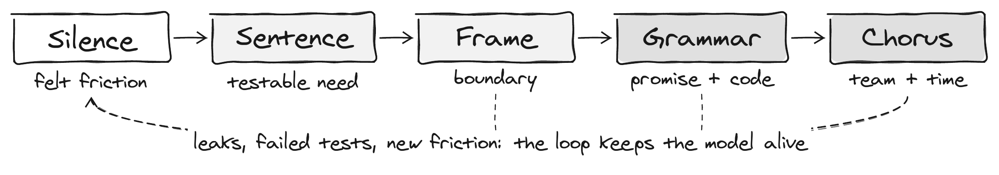

# WYSIWYG — What You ~~See~~ Say Is What You Get

**A Field Guide to Domain-Driven Design, Language, Models, Runtimes, and Teams**  
**Author:** Baris Güzelarslan

> *Developers are not primarily typing instructions. We are specifying a world in language, and code is the moment that specification becomes executable.*



## Overview

Human conversation runs on charity—say *"the order shipped late"* in a hallway and everyone quietly fills in the missing context. Compilers and runtimes have no charity to give. If a team does not choose its meaning deliberately, an accidental meaning still runs in production.

**WYSIWYG** reframes everything Domain-Driven Design calls *context*—bounded contexts, runtimes, platforms, Cynefin domains, team boundaries, and Agile delivery—as something language *does*. The guide follows a single piece of language across five movements and the living loop that brings mature systems back to Silence whenever reality pushes back:

| Movement | Language (what you say) | Context (what it draws) |
| :--- | :--- | :--- |
| **01 · Silence** | Friction is evidence, not yet a name. | Chaos: a context is cut out of the whole. |
| **02 · Sentence** | A need that could be wrong. | The semantic model: specify the world before encoding it. |
| **03 · Frame** | A bounded context is a disciplined refusal. | The boundary: drawn, not found. |
| **04 · Grammar** | Learn, explain, or repeat. | Cynefin, Ashby's Law, and an explicit runtime to carry the act. |
| **05 · Chorus** | A model lives in the people who can speak it. | Stream-aligned teams, platforms, event streams, and Agile over time. |

## Read the Guide

The compiled 34-page PDF is included directly in this repository:

- **[`wysiwyg.pdf`](wysiwyg.pdf)** — ready to read or download.

## Repository Structure

```text
.
├── wysiwyg.tex               # Main XeLaTeX source
├── wysiwyg.pdf               # Compiled 34-page PDF guide
├── README.md                 # Project overview and build instructions
├── .gitignore                # Ignores LaTeX build artifacts
├── fonts/
│   └── FG_Virgil.ttf         # Hand-drawn font used by the TikZ sketches
└── images/
    └── excalidraw/
        ├── sketch.tex        # Shared Excalidraw-style TikZ drawing kit
        ├── f00_five_movements.png  # Hero diagram rendered in this README
        ├── f00_*.tex / .pdf  # 16 standalone TikZ figure sources and compiled PDFs
        └── ...
```

## Building from Source

### Prerequisites

- **XeLaTeX** (TeX Live or MiKTeX) with standard packages (`tcolorbox`, `tikz`, `ulem`, `microtype`, `tabularx`, `booktabs`, `fancyhdr`, `needspace`, `enumitem`, `hyperref`, `unicode-math`)
- **IBM Plex fonts** installed on your system:
  - `IBM Plex Serif`
  - `IBM Plex Sans`
  - `IBM Plex Mono`
  - `IBM Plex Math`

### Build the PDF

Run `xelatex` twice so page counts, cross-references, and PDF bookmarks settle cleanly:

```bash
xelatex wysiwyg.tex
xelatex wysiwyg.tex
```

### Rebuild a Diagram (Optional)

All 16 figures in `images/excalidraw/` are standalone XeLaTeX/TikZ files using `sketch.tex` and `fonts/FG_Virgil.ttf`. To regenerate any figure PDF:

```bash
cd images/excalidraw
xelatex f00_five_movements.tex
```
